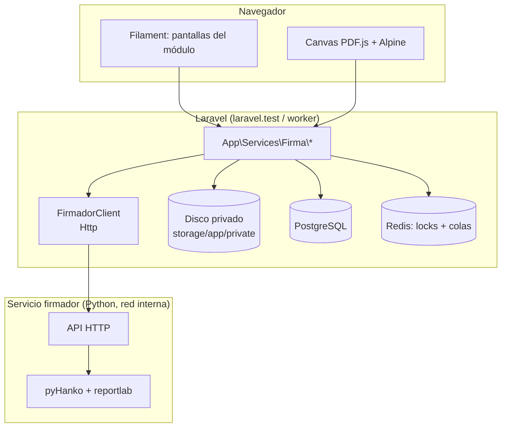

# 1. Arquitectura y motor de firma

## Componentes

## ¿Por qué un servicio firmador en Python?

Firmar con varios firmantes sobre el mismo PDF exige **firmas incrementales**: cada firma se agrega al final del archivo sin tocar las anteriores. Si se reescribe el archivo completo, las firmas previas quedan inválidas.

| Opción | Firmas incrementales (multi-firmante) | Sello personalizado | Madurez |
|---|---|---|---|
| **pyHanko (Python)** ✅ | Sí, nativo | Sí (ya probado) | Alta, ya validado con el `.p12` real |
| TCPDF / FPDI (PHP) | No: reescribe el PDF y rompe las firmas previas | Limitado | Media |
| SetaPDF-Signer (PHP) | Sí | Sí | Alta, pero es **de pago** |
| API de Viafirma | Sí | Según plataforma | Depende de contrato y acceso a la API |

**Recomendación:** un contenedor `firmador` con pyHanko, accesible **solo desde la red interna de Docker**. Laravel le habla por HTTP.

## Servicio `firmador`

- **Imagen:** `python:3.13-slim` con `pyhanko[image-support]`, `reportlab`, `fastapi` y `uvicorn`.
- **Ubicación del código:** `docker/firmador/` (Dockerfile, `app.py`, `requirements.txt`). Es una carpeta nueva y requiere aprobación.
- **Red:** sin puerto publicado hacia el host. Solo `laravel.test` y `worker` lo alcanzan (`http://firmador:8000`).
- **Autenticación:** token compartido en el header `X-Firmador-Token` (env `FIRMADOR_TOKEN`).
- **Sin disco:** todo se procesa en memoria. Si hiciera falta un temporal, se usa `tmpfs`. **No registra** el cuerpo de las peticiones.

### Endpoints

| Método | Ruta | Entrada | Salida |
|---|---|---|---|
| POST | `/certificados/inspeccionar` | `.p12` + contraseña | Titular (CN, CI, cargo/title, organización), emisor, serie, vigencia, huella SHA-256, `key_usage`; o un error claro |
| POST | `/pdf/inspeccionar` | PDF | Páginas (tamaño, rotación), si está cifrado, firmas existentes, si es válido |
| POST | `/pdf/preparar` | PDF + lista de campos `{nombre, pagina, x, y, ancho, alto}` | PDF con **campos de firma vacíos** |
| POST | `/pdf/firmar` | PDF + `.p12` + contraseña + nombre del campo + datos del sello + logo | PDF firmado (incremental) |
| POST | `/pdf/verificar` | PDF | Lista de firmas: firmante, fecha, íntegra, válida, cubre todo el documento |
| GET | `/salud` | — | `ok` (healthcheck de Docker) |

### Cliente en Laravel

- `App\Services\Firma\FirmadorClient` usa `Http::timeout(30)->withHeaders([...])->attach(...)`.
- Los errores se traducen a `App\Exceptions\FirmadorException`, con un `codigo` estable (`contrasena_incorrecta`, `certificado_vencido`, `pdf_cifrado`, `no_disponible`, etc.) que las pantallas convierten en mensajes claros.
- En las pruebas se usa `Http::fake()`, igual que hoy se *mockea* `BrowsershotPdfFactory`.

## Diseño del sello (aprobado en la prueba de concepto)

| Elemento | Valor |
|---|---|
| Tamaño del recuadro | **200 × 95 pt**, fijo |
| Logo | `public/images/Logo-Firma.png`, centrado arriba, 35 pt de alto |
| Línea 1 | **"Firmado digitalmente por:"**: Times-Bold, centrado |
| Líneas 2–4 | Nombre, cargo, fecha `dd/mm/YYYY HH:MM BOT`: Times-Roman, alineado a la izquierda, bloque centrado |
| Tamaño de letra / interlineado | 9,5 pt / 1,4 |
| Color del texto | `#1F3A8A` |
| Borde | Ninguno |

- **Nombre y cargo** se toman del registro del certificado (campos `nombre_en_sello` y `cargo_en_sello`, editables). Así se pueden corregir tildes que el certificado no trae, como "Calderón".
- **La fecha** es la del momento de la firma, en `America/La_Paz` (UTC-4).
- **Técnica:** el sello se dibuja con reportlab como un mini-PDF y pyHanko lo usa como apariencia (`StaticStampStyle`). No se usa `TextStampStyle` porque solo admite una fuente y un color, y tiene un bug de espaciado con fuentes TrueType.

## Tipo de firma

- **PAdES-B-B** (básica). La fecha de la firma la pone el **reloj del servidor/sistema**, en hora de Bolivia.
- El sello de tiempo externo (TSA, **PAdES-B-T**) queda **para más adelante** ([decisión 5](08-decisiones-pendientes.md#decisión-5-sello-de-tiempo-tsa)). Cuando se agregue, solo cambia el `firmador`.
- Todas las firmas son **de aprobación**, no de certificación (*DocMDP*). Así se permiten firmas posteriores sobre el mismo documento.
- **Todos los campos de firma se crean al preparar el documento**, antes de la primera firma. Agregar campos después de firmar puede marcar las firmas previas como "documento modificado" en algunos visores.
