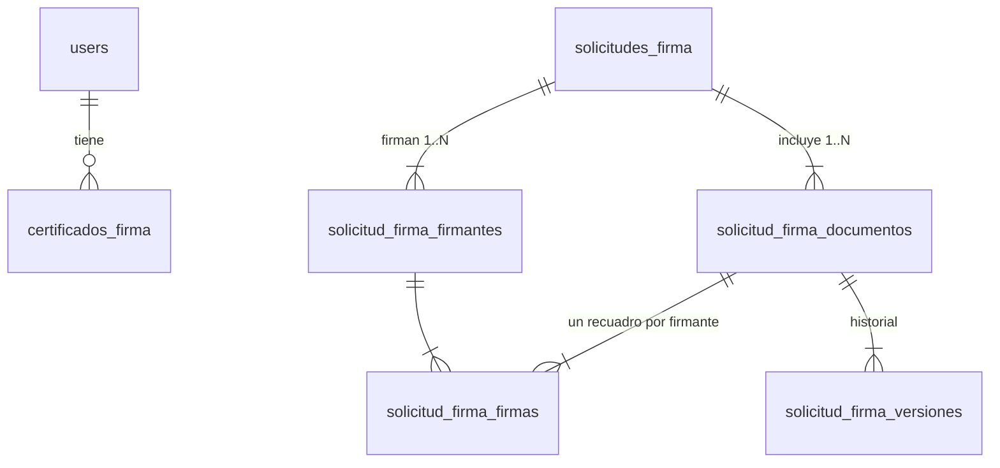

# 2. Modelo de datos

> Convenciones del proyecto: `users.id` es **UUID**. Los modelos usan `LogsIcuActivity` para la auditoría y las políticas se generan con Filament Shield (`Acción:Modelo`).

## Relación con lo existente

- La tabla actual `firmantes` (modelo `Firmante`) **no se modifica**. Solo indica qué nombres y cargos imprime la plantilla Blade bajo cada línea de firma (izquierda/centro/derecha).
- Al preparar un documento generado por el sistema, sus `firmantes` se usan para **pre-seleccionar** a los firmantes digitales, siempre que tengan una firma activa.
- Los PDFs actuales (`pdf_equipos`, `pdf_celulares`, `pdf_movimientos`, `recibo_equipos`) se enlazan de forma **polimórfica** como origen de cada documento.

## Vista general

**Solicitud** = el envío (asunto, mensaje, plazo). **Documento** = cada PDF del envío. **Firma** = el recuadro de un firmante en un documento, con su estado.

## Tablas nuevas

### `certificados_firma`: firma `.p12` de cada persona

> Los datos del certificado (`titular_*`, `emisor`, `numero_serie`, vigencia, `huella_sha256`) quedan **vacíos hasta la activación**: dentro del `.p12` están cifrados con su contraseña, que el admin no conoce.

| Columna | Tipo | Notas |
|---|---|---|
| id | bigint | |
| usuario_id | uuid FK users | Una firma **activa** por usuario (índice único parcial `WHERE estado = 'activo'`) |
| archivo | string | `.p12` **original** en el disco privado, cifrado en reposo ([ver seguridad](03-seguridad.md)) |
| contrasena_p12_envuelta | text, null | Contraseña del `.p12` **cifrada con una llave derivada de la contraseña del sistema** del titular. Incluye la sal y los parámetros de Argon2id, y todo va cifrado además con `FIRMA_ENCRYPTION_KEY`. `null` mientras no se active |
| contrasena_usuario_huella | string, null | Marca para detectar que la contraseña del sistema cambió por fuera del perfil (ver [seguridad](03-seguridad.md#cambios-de-contraseña-del-sistema)) |
| huella_sha256 | string(64), null | Huella del certificado, para detectar duplicados |
| titular_cn | string | Ej.: `VLADIMIR ADALID CALDERON SARMIENTO` |
| titular_documento | string, null | Nº de documento (CI). Digicert lo guarda en el atributo `1.3.6.1.1.1.1.0` (en tu certificado: `8347375`), **no** en `serialNumber` |
| titular_tipo_documento | string, null | Atributo `dnQualifier` (ej.: `CI`) |
| titular_cargo | string, null | Del atributo `title` |
| emisor | string | Ej.: `Entidad Certificadora Autorizada Digicert` |
| numero_serie | string | |
| vigente_desde / vigente_hasta | timestamp | |
| nombre_en_sello / cargo_en_sello | string | Editables (tildes, mayúsculas) |
| estado | enum `EstadoCertificadoFirma` | `pendiente_activacion`, `activo`, `requiere_reactivacion`, `reemplazado`, `revocado` |
| activado_at | timestamp, null | |
| reemplaza_a_id | FK self, null | Historial de renovaciones (una por año) |
| intentos_fallidos, bloqueado_hasta | tinyint, timestamp null | Bloqueo tras N contraseñas incorrectas al firmar |
| cargado_por | uuid FK users | |
| timestamps, soft deletes | | |

### `solicitudes_firma`: el envío

| Columna | Tipo | Notas |
|---|---|---|
| id | bigint | |
| codigo | string único | Ej.: `SF-2026-00042` (se muestra en correos y pantallas) |
| asunto, mensaje | string, text | Lo que leen los firmantes |
| orden_obligatorio | boolean | `false` por defecto: firma quien esté disponible. `true`: se respeta el `orden` de los firmantes |
| estado | enum `EstadoSolicitudFirma` | `borrador`, `en_curso`, `finalizada`, `cancelada` |
| fecha_limite | date, null | Se define al crear |
| recordatorio_cada_horas | unsigned smallint, null | Se define al crear (`null` = sin recordatorios) |
| creado_por | uuid FK users | |
| enviada_at, finalizada_at, cancelada_at | timestamp, null | |
| cancelada_por | uuid FK users, null | |
| motivo_cancelacion | text, null | |
| timestamps, soft deletes | | |

### `solicitud_firma_documentos`: cada PDF del envío

| Columna | Tipo | Notas |
|---|---|---|
| id | bigint | |
| solicitud_firma_id | FK | |
| nombre | string | Nombre visible (ej.: `FUE-0042.pdf`) |
| origen_type / origen_id | morphs, null | `PdfEquipo`, `PdfCelular`, `PdfMovimiento`, `ReciboEquipo`, o `null` si se subió |
| archivo_original | string | **Copia** del PDF original (snapshot) |
| archivo_actual | string | Última versión: preparada o con N firmas |
| hash_actual | string(64) | SHA-256 de `archivo_actual` |
| version | unsigned int | Aumenta con cada firma (**bloqueo optimista**) |
| paginas | json | Tamaño y rotación de cada página (lo devuelve el firmador). Lo usa el canvas |
| estado | enum `EstadoDocumentoFirma` | `borrador`, `en_curso`, `completado`, `rechazado`, `cancelado` |
| completado_at | timestamp, null | |
| timestamps | | |

### `solicitud_firma_firmantes`: quién firma el envío

| Columna | Tipo | Notas |
|---|---|---|
| id | bigint | |
| solicitud_firma_id | FK | |
| usuario_id | uuid FK users | |
| orden | unsigned tinyint | Posición en la lista. Solo se respeta si `orden_obligatorio = true` |
| ultimo_recordatorio_at | timestamp, null | |
| unique(solicitud_firma_id, usuario_id) | | |

### `solicitud_firma_firmas`: el recuadro de un firmante en un documento

| Columna | Tipo | Notas |
|---|---|---|
| id | bigint | |
| documento_id | FK solicitud_firma_documentos | |
| firmante_id | FK solicitud_firma_firmantes | |
| campo | string | Nombre del campo de firma en el PDF, ej.: `firma_3` |
| pagina | unsigned smallint | Página (desde 1) |
| x, y | decimal(8,2) | En **puntos PDF**, origen abajo-izquierda |
| ancho, alto | decimal(8,2) | Fijos: 200 × 95 |
| estado | enum `EstadoFirma` | `pendiente`, `firmado`, `rechazado` |
| certificado_firma_id | FK, null | Se fija **al firmar** (útil si renovó en medio del proceso) |
| firmado_at | timestamp, null | |
| motivo_rechazo | text, null | |
| unique(documento_id, firmante_id) | | |

### `solicitud_firma_versiones`: historial de archivos por documento

| Columna | Tipo | Notas |
|---|---|---|
| documento_id | FK | |
| version | unsigned int | 0 = preparado, 1 = primera firma, etc. |
| archivo | string | Cada versión se conserva, para trazabilidad |
| hash_sha256 | string(64) | |
| firma_id | FK solicitud_firma_firmas, null | Qué firma produjo esta versión |
| created_at | timestamp | |

### `firma_settings`: configuración del módulo (una fila)

Sigue el mismo patrón que `MailSetting` y `MediaSetting`.

| Columna | Por defecto | Notas |
|---|---|---|
| requiere_2fa_al_firmar | `false` | Si está activo, además de la contraseña se pide el código 2FA |
| intentos_maximos | 5 | Contraseñas incorrectas antes de bloquear |
| minutos_bloqueo | 15 | |
| plazo_dias_por_defecto | 3 | Valor inicial del formulario de envío |
| recordatorio_horas_por_defecto | 24 | Valor inicial del formulario de envío |

## Almacenamiento

- **Disco:** `local` (privado, `storage/app/private`). **Nunca** el disco `public`, aunque los PDFs generados hoy estén ahí.
- **Rutas:**
  - `firma-digital/certificados/{usuario_id}/{uuid}.p12.enc`
  - `firma-digital/solicitudes/{codigo}/{documento_id}/v{version}.pdf`
- **Descarga:** por una ruta protegida por la política (`Storage::download`), nunca con una URL pública. Para varios documentos se ofrece **descargar todo en un ZIP**.

## Modelos y enums nuevos

- **Modelos:** `CertificadoFirma`, `SolicitudFirma`, `SolicitudFirmaDocumento`, `SolicitudFirmaFirmante`, `SolicitudFirmaFirma`, `SolicitudFirmaVersion`, `FirmaSetting`.
- **Enums** (`app/Enums/`): `EstadoCertificadoFirma`, `EstadoSolicitudFirma`, `EstadoDocumentoFirma`, `EstadoFirma`.
- **Relación en** `User`**:** `certificadoFirmaActivo()` (HasOne con filtro `activo`), `certificadosFirma()`, `firmasPendientes()`.
- **Factories** con estados: `activo()`, `vencido()`, `pendienteActivacion()`, `requiereReactivacion()`, `ordenObligatorio()`, `finalizada()`.
