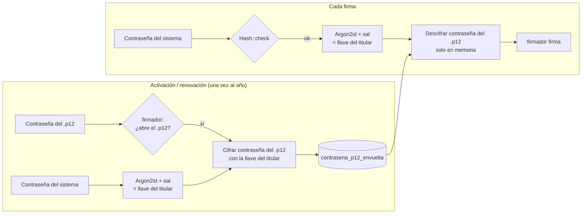

# 3. Seguridad

Quien tenga el `.p12` **y** su contraseña puede firmar en nombre de esa persona, con validez legal. Todo este documento parte de esa premisa.

## Custodia de los `.p12`

1. **Cifrado en reposo.** El archivo `.p12` original se guarda cifrado con una **clave dedicada** (`FIRMA_ENCRYPTION_KEY`, distinta de `APP_KEY`), usando `Illuminate\Encryption\Encrypter` con AES-256-GCM. Así, rotar `APP_KEY` no deja inutilizables las firmas.
2. **Disco privado** (`local`), sin URL pública. Se descifra **solo en memoria**, en el momento de firmar o activar.
3. **Triple protección:** para firmar hace falta el archivo, la clave del servidor **y** la contraseña del sistema del titular. Esta última solo la conoce el titular.
4. **Al eliminar o reemplazar** una firma, el archivo `.p12` se **borra físicamente**. Se conservan solo los metadatos para la auditoría.
5. **Respaldos:** los backups de `storage/app/private` y de `FIRMA_ENCRYPTION_KEY` se guardan **por separado**.

## Contraseña única: firmar con la contraseña del sistema

El titular firma con **la misma contraseña con la que entra al sistema**. El `.p12` conserva su contraseña original de Digicert: el archivo no se modifica. Esa contraseña se guarda **envuelta** (cifrada) con una llave que solo se obtiene a partir de la contraseña del sistema del titular.

- **No se guarda ninguna contraseña en texto plano.** La del sistema sigue siendo solo un hash (como hoy) y la del `.p12` queda cifrada con una llave que el servidor **no puede** calcular sin la contraseña del titular.
- **El admin no puede firmar por nadie:** aunque tenga acceso al servidor y a la base de datos, le falta la contraseña del titular.
- **Argon2id** (memoria 64 MB, 3 iteraciones) hace muy costoso adivinar la contraseña por fuerza bruta. La contraseña del sistema debe cumplir la política de contraseñas fuertes que ya existe.
- **La contraseña nunca se encola** ni se guarda en sesión, caché o logs. La firma se ejecuta de forma **síncrona** en la misma petición.
- En Livewire, la contraseña va en el formulario del modal (`TextInput::make('password')->password()`), **no** como propiedad pública del componente. Se descarta apenas se usa.
- Viaja de Laravel al `firmador` por la red interna de Docker. En producción el sitio va **solo por HTTPS**.

## Activación y renovación (contraseña del `.p12`)

El admin sube el `.p12`, pero **no conoce ninguna contraseña**. El titular lo activa en **Mi firma digital** con un asistente de dos pasos claramente diferenciados:

**Paso 1: Contraseña de tu archivo de firma (`.p12`)**

> 🔐 *Es la contraseña que definiste al descargar tu firma de **Digicert** (la misma que usas en **Viafirma**). **No** es tu contraseña del sistema ICU.*

- Se valida **en el momento** contra el `firmador`.
- Si falla **y** lo escrito coincide con la contraseña del sistema (`Hash::check`), el mensaje es específico: *"Escribiste tu contraseña del sistema ICU. Aquí va la contraseña de tu archivo .p12 (la de Digicert/Viafirma)"*.
- Si falla por otro motivo: *"La contraseña del archivo .p12 no es correcta"*.

**Paso 2: Confirma tu contraseña del sistema ICU**

> ✍️ *Desde ahora firmarás tus documentos con esta contraseña, la misma con la que entras al sistema.*

Si ambos pasos salen bien, se envuelve la contraseña del `.p12` y la firma queda **activa**.

**Renovación anual:**

1. El admin sube el nuevo `.p12` y se crea un registro `pendiente_activacion`.
2. El certificado anterior **sigue activo** hasta que el titular active el nuevo, para que no quede sin poder firmar.
3. El titular repite los dos pasos. El paso 1 pide la contraseña del **nuevo** `.p12`.
4. Al activarse, el anterior pasa a `reemplazado` y su archivo se borra.

Solo las firmas **activas y vigentes** aparecen en el selector de firmantes.

## Cambios de contraseña del sistema

| Cómo cambia | ¿Se actualiza la firma sola? | Qué pasa |
|---|---|---|
| El usuario la cambia en **Mi perfil** (`App\Livewire\Profile\UpdatePassword`) | ✅ **Sí** | Se tienen la contraseña actual y la nueva, así que se descifra con la anterior y se vuelve a cifrar con la nueva, en la misma transacción. No hace falta reactivar |
| Recuperación **por correo** (`App\Filament\Pages\Auth\ResetPassword` / `RecuperacionPassword`) | ❌ No | No se conoce la contraseña anterior y no hay forma de recuperar la del `.p12` |
| Restablecida por un **admin** (`UserForm`, `ManageUserSeguridad`) | ❌ No | Ídem |
| Importación de usuarios (`UserImporter`) | ❌ No | Ídem |

**Por qué no se puede automatizar el restablecimiento:** para hacerlo, el servidor tendría que guardar una copia de la contraseña del `.p12` que pueda abrir **sin** la contraseña del titular. En ese caso cualquiera con acceso al servidor podría firmar en nombre de todos, y se perdería la garantía de que solo el titular firma.

**Cómo se detecta** (cubre los casos ❌ sin depender de cada pantalla):

- Un `UserObserver` en el evento `updated` revisa `wasChanged('password')`.
- Al activar o recifrar se guarda `contrasena_usuario_huella`, una huella del hash de contraseña con el que se envolvió. El flujo de perfil la actualiza **antes** de guardar el nuevo hash. Si el hash cambió y la huella ya no coincide (el cambio no vino de Mi perfil) y el usuario tiene una firma `activo`:
  1. La firma pasa a `requiere_reactivacion` y se borra `contrasena_p12_envuelta`, que ya no sirve.
  2. Se notifica por **correo y campana** a:
     - **El usuario**, con instrucciones: *"Tu contraseña del sistema fue restablecida. Para volver a firmar, entra a Mi firma digital → Reactivar. Necesitarás la contraseña de tu archivo .p12 (la de Digicert/Viafirma) y tu nueva contraseña del sistema."*
     - **Admins y super admins** (`AdminRecipients::all()`), con el nombre del usuario, cuándo y cómo cambió la contraseña (correo o admin, y quién lo hizo), y los pasos para guiarlo.
  3. Queda registrado en la auditoría (`AuditorSeguridad`).
- Si el usuario **olvidó también** la contraseña del `.p12`, debe pedir a Digicert una nueva emisión o reposición. El admin sube el archivo nuevo, como en una renovación.

## Validaciones del `.p12`

| Validación | Cuándo |
|---|---|
| Extensión `.p12`/`.pfx`, tamaño ≤ 100 KB, estructura PKCS#12 | Al subir (admin) |
| Huella no asignada a otro usuario | Al activar (antes no se puede leer el certificado) |
| Abre con la contraseña del `.p12` | Al activar (paso 1) |
| La clave privada corresponde al certificado | Al activar |
| Vigencia: `vigente_desde ≤ hoy < vigente_hasta` | Al activar y antes de **cada** firma |
| `keyUsage` incluye `digitalSignature` o `nonRepudiation` | Al activar |
| Nº de documento del certificado (`titular_documento`) = `users.carnet` del usuario asignado | Al activar. Si no coincide, se bloquea con un mensaje claro |

## Intentos de contraseña al firmar

- Máximo `intentos_maximos` (5) por titular. Después, la firma queda bloqueada `minutos_bloqueo` (15 min) y se notifica a los admins (`AuditorSeguridad`).
- *Rate limit* por usuario en la acción de firmar (`RateLimiter`).
- **2FA opcional:** si `requiere_2fa_al_firmar` está activo en *Configuración → Firma digital*, además se pide el código 2FA (Breezy/FortiToken). Está **desactivado** por defecto.

## Validación de PDFs subidos

- Tipo MIME `application/pdf` **y** cabecera `%PDF-`.
- Tamaño ≤ `archivos.max_pdf_kb` (hoy 10 MB).
- El `firmador` debe poder abrirlo (`/pdf/inspeccionar`). Se rechazan PDFs **cifrados** o con contraseña.
- Si el PDF trae firmas previas, se avisa: los campos nuevos se agregan de forma incremental y las firmas existentes se conservan.
- Se guarda una copia propia (snapshot) con su hash. Lo que se firma es esa copia, no el archivo original del sistema.

## Integridad del documento

- Antes de cada firma: `sha256(archivo_actual) == hash_actual`. Si no coincide, se aborta y se alerta (alguien tocó el archivo en disco).
- Después de cada firma: `/pdf/verificar`. Todas las firmas deben quedar íntegras y válidas antes de guardar la nueva versión.
- Mientras un documento esté `en_curso`, se **bloquea la regeneración** de su PDF de origen (acciones "Generar" en `PdfEquipo`, `PdfCelular` y `PdfMovimiento`).

## Autorización (Shield)

| Permiso | Para |
|---|---|
| `ViewAny/Create/Update/Delete:CertificadoFirma` | Admin de firmas (pantalla 1). Gestiona las firmas de **todos**, incluida la suya |
| `ViewAny/Create:SolicitudFirma` | Quien prepara y envía documentos (pantalla 2) |
| `Cancel:SolicitudFirma` (custom) | Admins: cancelar **cualquier** envío en curso |
| — | **Cancelar** su propio envío: siempre permitido al creador (`SolicitudFirmaPolicy::cancelar`) |
| — | **Firmar** no es un permiso de rol. Lo decide la política: el usuario es firmante pendiente, tiene firma activa y vigente, y si hay orden obligatorio, ya le toca |
| — | **Ver o descargar**: el creador, sus firmantes y quien tenga `View:SolicitudFirma` |

## Auditoría

- Los modelos nuevos usan `LogsIcuActivity` (log `firma_digital` en `DominioActividad`).
- Eventos explícitos:
  - Certificado: cargado, activado, reactivado, renovado o revocado.
  - Firma pasada a `requiere_reactivacion`, indicando el motivo.
  - Envío: creado, enviado o cancelado.
  - Firma: realizada, rechazada o con contraseña incorrecta.
  - Descarga del documento final.
- **Nunca** se registran contraseñas ni el contenido del `.p12`.
