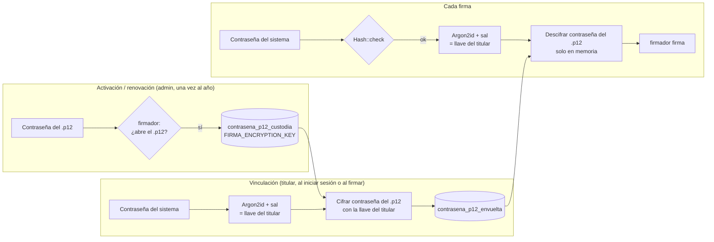

# 3. Seguridad

Quien tenga el `.p12` **y** su contraseña puede firmar en nombre de esa persona, con validez legal. Todo este documento parte de esa premisa.

## Custodia de los `.p12`

1. **Cifrado en reposo.** El archivo `.p12` original se guarda cifrado con una **clave dedicada** (`FIRMA_ENCRYPTION_KEY`, distinta de `APP_KEY`), usando `Illuminate\Encryption\Encrypter` con AES-256-GCM. Así, rotar `APP_KEY` no deja inutilizables las firmas.
2. **Disco privado** (`local`), sin URL pública. Se descifra **solo en memoria**, en el momento de firmar, activar o vincular.
3. **Contraseña del `.p12` en custodia.** El admin la escribe al asignar o renovar la firma y se guarda en `contrasena_p12_custodia`, cifrada con la misma `FIRMA_ENCRYPTION_KEY` (`BovedaCertificados::cifrar`). Se conserva mientras la firma está vigente y se borra al revocarla o reemplazarla. Sirve para vincular (y reactivar) la firma con la contraseña del sistema sin pedirle al titular la del `.p12`.
4. **Para firmar desde el sistema** hace falta el archivo, la clave del servidor **y** la contraseña del sistema del titular (más el 2FA si está activado). Ver la [contrapartida de la custodia](#contrapartida-de-la-custodia).
5. **Al eliminar o reemplazar** una firma, el archivo `.p12` se **borra físicamente** y se vacía la custodia. Se conservan solo los metadatos para la auditoría.
6. **Respaldos:** los backups de `storage/app/private`, de la base de datos y de `FIRMA_ENCRYPTION_KEY` se guardan **por separado**. Proteger `FIRMA_ENCRYPTION_KEY` es **crítico** (ver abajo).

## Contraseña única: firmar con la contraseña del sistema

El titular firma con **la misma contraseña con la que entra al sistema** y nunca necesita la del `.p12`. El `.p12` conserva su contraseña original de Digicert: el archivo no se modifica. Además de la copia en custodia, esa contraseña se guarda **envuelta** (cifrada) con una llave que solo se obtiene a partir de la contraseña del sistema del titular; es la que se usa al firmar.

- **No se guarda ninguna contraseña en texto plano.** La del sistema sigue siendo solo un hash (como hoy). La del `.p12` queda en dos copias cifradas: la custodia (con `FIRMA_ENCRYPTION_KEY`) y la envuelta (con la llave del titular).
- **Firmar desde la aplicación** exige siempre la contraseña del sistema del titular (y el 2FA si está activado): el admin no puede firmar por nadie desde las pantallas.
- **Argon2id** (memoria 64 MB, 3 iteraciones) hace muy costoso adivinar la contraseña por fuerza bruta. La contraseña del sistema debe cumplir la política de contraseñas fuertes que ya existe.
- **La contraseña nunca se encola** ni se guarda en sesión, caché o logs. La firma se ejecuta de forma **síncrona** en la misma petición.
- En Livewire, la contraseña va en el formulario del modal (`TextInput::make('password')->password()`), **no** como propiedad pública del componente. Se descarta apenas se usa.
- Viaja de Laravel al `firmador` por la red interna de Docker. En producción el sitio va **solo por HTTPS**.

## Activación y renovación (contraseña del `.p12`)

> **Cambio (2026-10-30):** antes el admin subía el `.p12` sin contraseña (`pendiente_activacion`) y el titular lo activaba en *Mi firma digital* con un asistente de dos pasos (contraseña del `.p12` + contraseña del sistema). Los dueños decidieron que **el admin escribe la contraseña del `.p12`** y el titular solo usa su contraseña del sistema.

**Activación (admin).** En *Configuración → Firmas digitales → Asignar firma* el admin sube el `.p12` **y** escribe su contraseña. Todas las [validaciones](#validaciones-del-p12) se hacen en ese momento. Si pasan, la firma queda **`activo`** de inmediato, con la contraseña en custodia y `contrasena_p12_envuelta = null` (**pendiente de vincular**). Se registra `firma_digital_activada` (causante: el admin; sujeto: el titular) y se avisa al titular.

**Vinculación (titular, automática).** `App\Services\Firma\VincularCertificadoFirma` descifra la custodia, la envuelve con la contraseña del sistema del titular (Argon2id, `EnvolturaContrasena`) y guarda `contrasena_usuario_huella`. Ocurre:

1. Al **iniciar sesión** correctamente (`App\Filament\Pages\Auth\Login::authenticate`). Si falla, **nunca** impide el inicio de sesión.
2. La primera vez que el titular **firma** o usa **"Probar mi firma"** (`AbrirCredencialesFirma` / `FirmarDocumentoDePrueba`), después de las comprobaciones normales de contraseña, 2FA e intentos.
3. A mano, con el botón **"Vincular mi firma"** en *Mi firma digital* (pide solo la contraseña del sistema).

El titular **nunca** necesita la contraseña del `.p12` ni "activa" nada. Se registra `firma_digital_vinculada`.

**Renovación anual:**

1. El admin usa **Renovar (nuevo .p12)**: sube el archivo nuevo y escribe su contraseña. Se valida igual que al asignar.
2. La nueva firma queda `activo` (pendiente de vincular) **en el acto**, y la anterior pasa a `reemplazado`: se borran su archivo y su custodia. Si había una firma heredada `pendiente_activacion`, pasa a `revocado`.
3. El titular no hace nada: la nueva se vincula en su próximo inicio de sesión o firma.

**Firmas heredadas sin custodia** (activadas con el flujo anterior, o `pendiente_activacion` subidas sin contraseña): el admin las activa o reactiva con la acción **"Activar firma" / "Reactivar firma"** de la tabla, que pide solo la contraseña del `.p12`. Solo aparece en `pendiente_activacion` o `requiere_reactivacion` y sin custodia.

Solo las firmas **activas y vigentes** aparecen en el selector de firmantes.

### Contrapartida de la custodia

Con la copia en custodia, **quien tenga la base de datos y `FIRMA_ENCRYPTION_KEY`** puede recuperar la contraseña del `.p12`, y el `.p12` cifrado está en el mismo servidor. Técnicamente, entonces, el servidor **podría firmar sin el titular**; con el flujo anterior no podía. Fue una **decisión explícita de los dueños** a cambio de comodidad: una sola contraseña, el titular no necesita la del `.p12` y puede reactivar su firma por sí mismo.

En consecuencia:

- `FIRMA_ENCRYPTION_KEY` pasa a ser **crítica**: fuera del repositorio, con acceso mínimo y respaldada aparte de la base de datos y de `storage/app/private`.
- Firmar **desde la aplicación** sigue exigiendo siempre la contraseña del sistema del titular (más el 2FA opcional), con contador de intentos y auditoría.

## Cambios de contraseña del sistema

| Cómo cambia | ¿Se actualiza la firma sola? | Qué pasa |
|---|---|---|
| El usuario la cambia en **Mi perfil** (`App\Livewire\Profile\UpdatePassword`) | ✅ **Sí** | Se tienen la contraseña actual y la nueva, así que se descifra con la anterior y se vuelve a cifrar con la nueva, en la misma transacción. No hace falta reactivar |
| Recuperación **por correo** (`App\Filament\Pages\Auth\ResetPassword` / `RecuperacionPassword`) | ⏸️ Pasa a `requiere_reactivacion` | No se conoce la contraseña anterior. Con custodia, el titular la reactiva solo con su **nueva** contraseña del sistema |
| Restablecida por un **admin** (`UserForm`, `ManageUserSeguridad`) | ⏸️ Ídem | Ídem |
| Importación de usuarios (`UserImporter`) | ⏸️ Ídem | Ídem |

**Por qué no se recifra en el acto:** la envoltura se hizo con la contraseña anterior, que no se conoce. La custodia sí se conserva, así que basta con que el titular entre con la nueva contraseña para volver a envolverla.

**Cómo se detecta** (cubre los casos ❌ sin depender de cada pantalla):

- Un `UserObserver` en el evento `updated` revisa `wasChanged('password')`.
- Al vincular o recifrar se guarda `contrasena_usuario_huella`, una huella del hash de contraseña con el que se envolvió. El flujo de perfil la actualiza **antes** de guardar el nuevo hash. Si el hash cambió y la huella ya no coincide (el cambio no vino de Mi perfil) y el usuario tiene una firma `activo`:
  1. La firma pasa a `requiere_reactivacion` y se borra `contrasena_p12_envuelta`, que ya no sirve. La **custodia se conserva**.
  2. Se notifica por **correo y campana** a:
     - **El usuario**: su firma quedó en pausa y se reactiva sola al **iniciar sesión con la nueva contraseña**; si ya tiene la sesión abierta, con **"Reactivar mi firma"** en *Mi firma digital* (pide solo la nueva contraseña del sistema).
     - **Admins y super admins** (`AdminRecipients::all()`), con el nombre del usuario, cuándo y cómo cambió la contraseña, y que **no tienen que hacer nada**.
  3. Queda registrado en la auditoría (`AuditorSeguridad`).
- **Firma heredada sin custodia:** los avisos dicen que debe reactivarla un admin (acción **"Reactivar firma"**, con la contraseña del `.p12`).
- Si se pierde la contraseña del `.p12` de una firma sin custodia, hay que pedir a Digicert una nueva emisión o reposición. El admin sube el archivo nuevo, como en una renovación.

## Validaciones del `.p12`

| Validación | Cuándo |
|---|---|
| Extensión `.p12`/`.pfx`, tamaño ≤ 100 KB, estructura PKCS#12 | Al subir (admin) |
| Abre con la contraseña del `.p12` | Al asignar o renovar (admin escribe la contraseña) |
| Huella no asignada a otro usuario | Al asignar o renovar |
| La clave privada corresponde al certificado | Al asignar o renovar |
| Vigencia: `vigente_desde ≤ hoy < vigente_hasta` | Al asignar o renovar, y antes de **cada** firma |
| `keyUsage` incluye `digitalSignature` o `nonRepudiation` | Al asignar o renovar |
| Nº de documento del certificado (`titular_documento`) = `users.carnet` del usuario asignado | Al asignar o renovar. Si no coincide, se bloquea con un mensaje claro |

Las mismas validaciones corren en la acción **"Activar / Reactivar firma"** de las firmas heredadas.

## Intentos de contraseña al firmar

- Máximo `intentos_maximos` (5) por titular. Después, la firma queda bloqueada `minutos_bloqueo` (15 min) y se notifica a los admins (`AuditorSeguridad`).
- *Rate limit* por usuario en la acción de firmar (`RateLimiter`).
- **2FA opcional:** si `requiere_2fa_al_firmar` está activo en *Configuración → Firma digital*, además se pide el código 2FA (Breezy/FortiToken). Está **desactivado** por defecto.

## Validación de PDFs subidos

- Tipo MIME `application/pdf` **y** cabecera `%PDF-`.
- Tamaño ≤ `archivos.max_pdf_kb` (hoy 10 MB).
- El `firmador` debe poder abrirlo (`/pdf/inspeccionar`). Se rechazan PDFs **cifrados** o con contraseña.
- Si el PDF trae firmas previas, se avisa: los campos nuevos se agregan de forma incremental y las firmas existentes se conservan.
- Se guarda una copia propia (snapshot) con su hash. Lo que se firma es esa copia, no el archivo original del sistema.

## Integridad del documento

- Antes de cada firma: `sha256(archivo_actual) == hash_actual`. Si no coincide, se aborta y se alerta (alguien tocó el archivo en disco).
- Después de cada firma: `/pdf/verificar`. Todas las firmas deben quedar íntegras y válidas antes de guardar la nueva versión.
- Mientras un documento esté `en_curso`, se **bloquea la regeneración** de su PDF de origen (acciones "Generar" en `PdfEquipo`, `PdfCelular` y `PdfMovimiento`).

## Autorización (Shield)

| Permiso | Para |
|---|---|
| `ViewAny/Create/Update/Delete:CertificadoFirma` | Admin de firmas (pantalla 1). Gestiona las firmas de **todos**, incluida la suya |
| `ViewAny/Create:SolicitudFirma` | Quien prepara y envía documentos (pantalla 2) |
| `Cancel:SolicitudFirma` (custom) | Admins: cancelar **cualquier** envío en curso |
| — | **Cancelar** su propio envío: siempre permitido al creador (`SolicitudFirmaPolicy::cancelar`) |
| — | **Firmar** no es un permiso de rol. Lo decide la política: el usuario es firmante pendiente, tiene firma activa y vigente, y si hay orden obligatorio, ya le toca |
| — | **Ver o descargar**: el creador, sus firmantes y quien tenga `View:SolicitudFirma` |

## Auditoría

- Los modelos nuevos usan `LogsIcuActivity` (log `firma_digital` en `DominioActividad`).
- Eventos explícitos:
  - Certificado: cargado, activado (`firma_digital_activada`, causante el admin y sujeto el titular), renovado o revocado.
  - Vinculado con la contraseña del sistema, también al reactivar (`firma_digital_vinculada`: *"Vinculó su firma digital con su contraseña"*).
  - Firma pasada a `requiere_reactivacion`, indicando el motivo.
  - Envío: creado, enviado o cancelado.
  - Firma: realizada, rechazada o con contraseña incorrecta.
  - Descarga del documento final.
- **Nunca** se registran contraseñas (ni la custodia ni la envuelta) ni el contenido del `.p12`.
