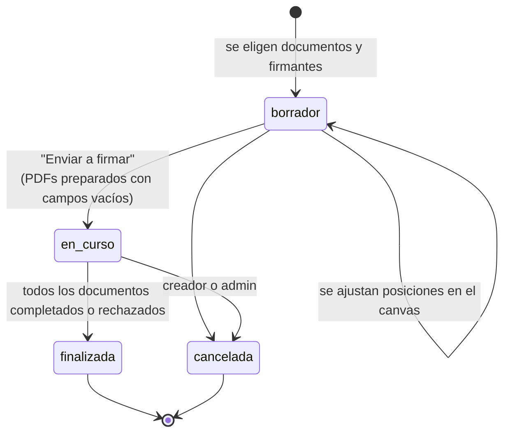
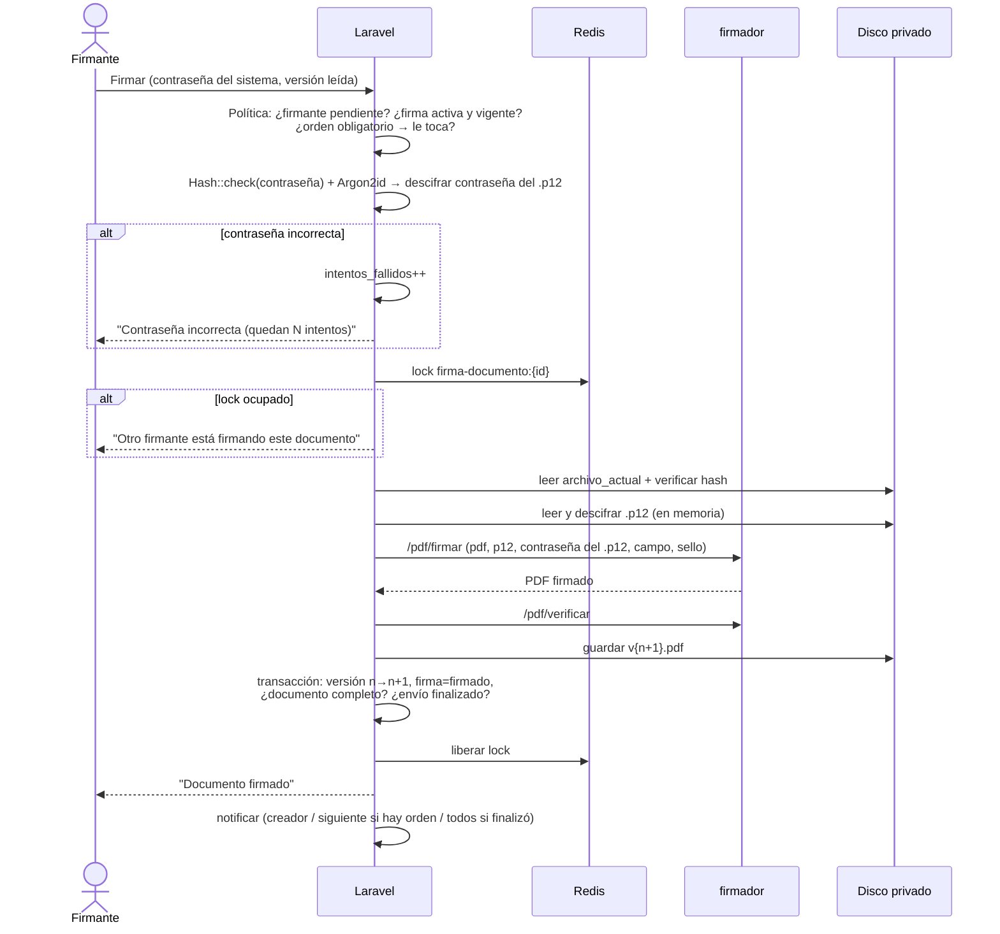

# 4. Flujo de firma y bloqueo

## Estados

**Envío (`solicitudes_firma`)**



- **Documento:** `en_curso` → `completado` (cuando están todas sus firmas) · `rechazado` (cuando un firmante lo rechaza) · `cancelado`.
- **Firma** (recuadro de un firmante en un documento): `pendiente` → `firmado` o `rechazado`.

## Orden de firma

### Por defecto: orden libre

- **Cualquier firmante pendiente puede firmar cuando esté disponible.** Si Juanito ya firmó y Pedro está de viaje, Carlos firma igual, y Pedro firma al volver.
- Al enviar, **se notifica a todos los firmantes a la vez**.
- El orden no importa técnicamente: todos los recuadros (campos de firma) se crean al preparar el PDF, y cada firma se agrega de forma incremental sobre la versión más reciente.

### Opcional: "Exigir orden"

- Casilla al preparar el envío. Quien envía **elige el orden** arrastrando la lista de firmantes.
- Solo puede firmar el primero que aún no firmó. Se notifica **al siguiente** cuando le toca.
- Si alguien del medio no está disponible, el creador puede **reemplazar al firmante** pendiente o **quitar el orden obligatorio** del envío en curso.

## Bloqueo: una persona a la vez por documento

El orden es libre, pero **dos personas nunca firman el mismo documento al mismo tiempo**. Hay dos mecanismos que se complementan.

### 1. Bloqueo exclusivo durante la firma (Redis)

```php
$lock = Cache::lock("firma-documento:{$documento->id}", 60);

if (! $lock->get()) {
    // "Otro firmante está firmando este documento en este momento. Intenta en unos segundos."
}

try {
    // ... firmar ...
} finally {
    $lock->release();
}
```

- El bloqueo es **por documento**, no por envío. Si Carlos firma el documento A, Pedro puede firmar el B al mismo tiempo.
- El TTL de 60 s libera el bloqueo si el proceso se cae a la mitad.

### 2. Bloqueo optimista por versión (base de datos)

- La pantalla carga cada documento con su `version` y la envía al firmar.
- Al guardar el resultado, se hace en una transacción:

```php
$actualizados = SolicitudFirmaDocumento::whereKey($id)
    ->where('version', $versionLeida)
    ->update(['version' => $versionLeida + 1, 'archivo_actual' => $nuevo, 'hash_actual' => $hash]);

if ($actualizados === 0) {
    // Otro firmante firmó este documento mientras tanto: se descarta lo recién firmado
    // y se reintenta automáticamente una vez sobre la versión nueva.
}
```

- Como el orden es libre, este caso es **normal**. Por eso se **reintenta solo una vez**, sin molestar al usuario. Así, cada firma queda siempre sobre el archivo con todas las firmas anteriores.

## Firmar uno o todos

Cuando un envío tiene varios documentos, el firmante elige:

- **Firmar este documento:** firma solo el que está viendo.
- **Firmar todos mis pendientes de este envío:** escribe la contraseña **una sola vez** y se firman uno tras otro.
  - Se valida la contraseña, se descifra la contraseña del `.p12` y se lee el `.p12` **una vez**, en memoria.
  - Se recorre cada documento con su propio lock y su propia versión.
  - Si un documento falla (por ejemplo, está bloqueado por otro firmante), se continúa con los demás.
  - Al final se muestra un resumen: *"3 de 4 firmados. 'FUE-0042.pdf' estaba siendo firmado por otra persona: inténtalo en unos segundos"*.
  - Se ejecuta en la misma petición (sin colas, para que la contraseña no se guarde). Hay un tope de **20 documentos** por lote para no superar el tiempo de la petición.

## Paso a paso de "Firmar" (un documento)



**Servicios** (`App\Services\Firma\`): una clase invocable por cada caso de uso.

- Firma: `FirmarDocumento`, `FirmarLote` (que usa `FirmarDocumento`), `PrepararSolicitudFirma`, `RechazarFirma`, `CancelarSolicitudFirma`.
- Certificados: `ActivarCertificado`, `RecifrarCertificadoTrasCambioDeContrasena`, `MarcarCertificadoParaReactivacion`.

## Casos borde

| Caso | Comportamiento |
|---|---|
| El certificado vence con firmas pendientes | Al intentar firmar se bloquea y se avisa al titular y al admin para renovarlo |
| El titular renueva su `.p12` en medio del envío | Firma con el nuevo una vez activado (`certificado_firma_id` se fija al firmar) |
| La contraseña del sistema se restableció y la firma quedó `requiere_reactivacion` | No puede firmar hasta reactivar. Al intentarlo, ve el botón **"Reactivar mi firma"** |
| Se desactiva un firmante | El creador puede reemplazarlo por otro con firma activa, o quitarlo si ya no hace falta |
| Un firmante rechaza un documento | Ese documento pasa a `rechazado`, se notifica al creador y a los firmantes, y los demás documentos del envío siguen su curso |
| Alguien intenta regenerar el PDF de origen | Bloqueado mientras el documento esté `en_curso` |
| Se cae el `firmador` | Error controlado ("Servicio de firma no disponible"), el lock se libera y no se pierde nada |
