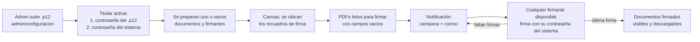

# Módulo de Firma Digital — Plan general

## Objetivo

Integrar al Sistema ICU un módulo que permita **firmar digitalmente, recepcionar y notificar** documentos PDF ya generados (altas/bajas, entregas/recepciones) o subidos al sistema. Las firmas se hacen con los certificados `.p12` de cada persona, que son los mismos que se usan en Viafirma (emitidos por *Entidad Certificadora Autorizada Digicert*, Bolivia).

Principios guía: **escalabilidad, seguridad, simplicidad y buena experiencia de usuario**.

> ⚠️ **Regla de oro:** la firma **nunca es automática**. Cada firma exige que el titular escriba **su contraseña del sistema** (la misma del login) en el momento de firmar. El sistema **no guarda ninguna contraseña en texto plano**.

## Decisiones tomadas

| Tema | Decisión |
|---|---|
| Motor de firma | Servicio propio `firmador` (pyHanko), sin Viafirma |
| Carga de `.p12` | **Solo el admin** sube las firmas de todos, incluida la suya. **Cada titular la activa** con la contraseña de su `.p12` |
| Contraseña para firmar | **La contraseña del sistema.** La del `.p12` se pide solo al activar o renovar |
| Cambio de contraseña del sistema | Desde el perfil, la firma se actualiza sola. Si un admin la restablece o se recupera por correo, la firma pasa a **requiere reactivación** y se avisa por correo al usuario, a los admins y a los super admins |
| Orden de firma | **Libre por defecto:** firma quien esté disponible. Opcional: **"Exigir orden"**, con el orden elegido por quien envía |
| Documentos por envío | **Uno o varios.** El firmante puede firmar **todos de una vez** (una sola contraseña) o **uno por uno** |
| 2FA al firmar | Desactivado por defecto. Se puede activar en *Configuración → Firma digital* |
| Rechazo | Incluido, con motivo obligatorio |
| Firmantes | Solo usuarios con firma activa. No hay firma alternativa para quien no tiene `.p12` |
| Plazo y recordatorios | Se configuran en cada envío, con valores por defecto editables |
| Cancelar un envío | Solo quien lo creó o un admin |
| Fecha de la firma | Reloj del servidor/sistema (hora de Bolivia). El sello de tiempo externo (TSA) queda para después |
| Emisor del `.p12` | No se valida: todas son de Digicert y de origen legal |

## Flujo resumido

## Documentos de este plan

| # | Documento | Contenido |
|---|---|---|
| 1 | [Arquitectura y motor de firma](01-arquitectura-y-motor-de-firma.md) | Componentes, servicio firmador (pyHanko), diseño del sello |
| 2 | [Modelo de datos](02-modelo-de-datos.md) | Tablas, estados y relación con lo existente |
| 3 | [Seguridad](03-seguridad.md) | Custodia de `.p12`, contraseña única, cambios de contraseña, auditoría |
| 4 | [Flujo de firma y bloqueo](04-flujo-de-firma-y-bloqueo.md) | Estados, orden libre u obligatorio, bloqueo y versiones, firma en lote |
| 5 | [Pantallas](05-pantallas.md) | Configuración, Mi firma digital, preparación + canvas, firma |
| 6 | [Notificaciones](06-notificaciones.md) | Campana, correo, recordatorios, vencimientos y reactivación |
| 7 | [Plan de implementación](07-plan-de-implementacion.md) | Fases, tareas y pruebas, en orden |
| 8 | [Decisiones y riesgos](08-decisiones-pendientes.md) | Decisiones tomadas, lo que falta y los riesgos |

## Prueba de concepto (ya validada)

En la carpeta local `.firma-digital/` (fuera de git) está `firmar.py`. Ese script ya demostró:

- Abrir el `.p12` de Digicert.
- Firmar un PDF en formato **PAdES** con el sello aprobado.
- Verificar la firma: documento íntegro y firma válida.

El motor de firma del módulo se construye sobre ese mismo código ([ver documento 1](01-arquitectura-y-motor-de-firma.md)).

## Alcance

- **Incluye:** altas y bajas, entrega y recepción (equipos y celulares), notas de salida/recepción y cualquier PDF subido al sistema. Ningún documento es de firma obligatoria: simplemente se envía a firmar.
- **No incluye (por ahora):** firma sin entrar al sistema, firma para usuarios sin `.p12`, ni integración por API con Viafirma.
